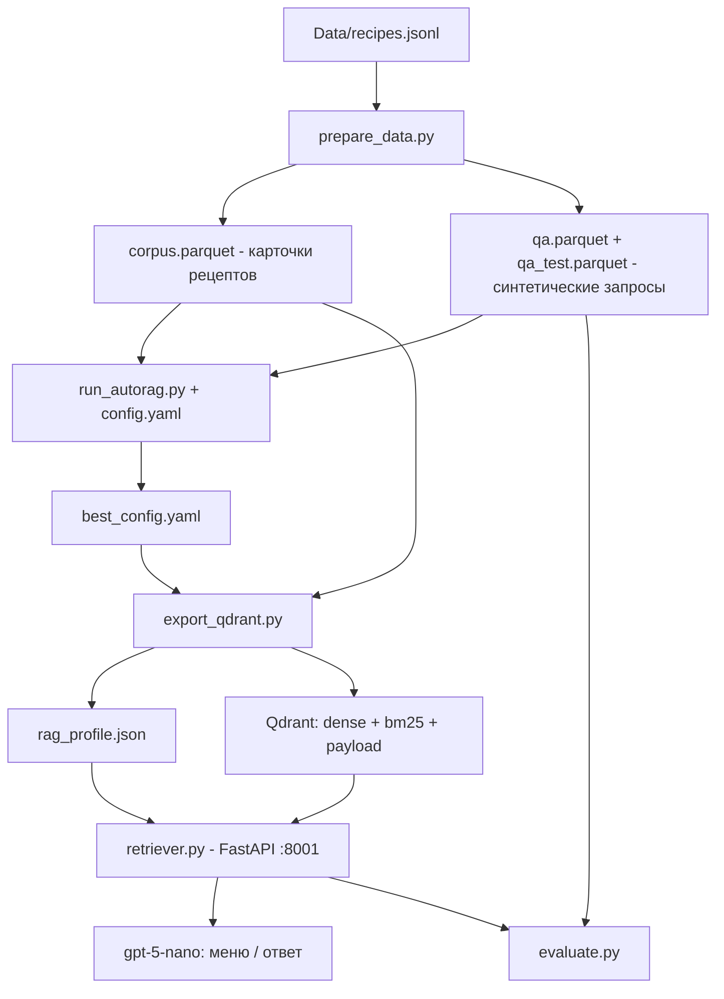

# AutoRAG: подбор оптимального RAG по рецептам и экспорт в Qdrant

Решение в папке `AutoRag/`. С помощью [AutoRAG](https://docs.auto-rag.com) на синтетическом русскоязычном наборе запросов перебираются модели эмбеддингов, BM25, гибридный поиск, реранкер и промпты. Лучший пайплайн переносится в продакшн-коллекцию Qdrant, а контекст из неё передаётся в gpt-5-nano.

Простое решение без AutoRAG описано в [DirectIndex.md](DirectIndex.md). Оно служит базовой линией для сравнения.

## Схема



## Файлы

| Файл | Назначение |
|---|---|
| `prepare_data.py` | Шаг 1: `corpus.parquet` (карточки рецептов), генерация QA-набора, разбиение dev/test |
| `config.yaml` | Пространство поиска AutoRAG: какие модули и параметры сравнивать |
| `run_autorag.py` | Шаг 2: запуск трайла AutoRAG и сохранение `best_config.yaml` |
| `export_qdrant.py` | Шаг 3: `best_config.yaml` → `rag_profile.json` + индексация в Qdrant |
| `evaluate.py` | Шаг 4: recall, MRR и nDCG продакшн-коллекции на отложенной выборке |
| `retriever.py` | Продакшн RAG-сервер FastAPI (API как у `DirectIndex/rag_server.py` + `/search`), функции поиска для `export_qdrant.py`/`evaluate.py`, CLI |
| `paths.py` | Все пути. Задаются переменными `DATA_FILE`, `WORK_DIR` и `AUTORAG_CONFIG` |
| `Dockerfile`, `Makefile` | Сборка образа и запуск шагов |

## Ключевые решения

- **Один рецепт = один документ.** Рецепт в среднем ~1700 символов, а агент выбирает рецепты целиком. Чанкинг только размазал бы рецепт по частям.
- **Компактная «карточка» вместо полного текста** (`--variant card`): ID, название, тип, ингредиенты, КБЖУ, аллергены. Шаги приготовления не нужны для выбора блюда, они только тратят контекст и внимание gpt-5-nano. Полный текст лежит в payload (`text`) для показа пользователю. Для сравнения можно собрать `--variant full`.
- **QA-набор генерируется своим скриптом.** У AutoRAG нет встроенных промптов для генерации QA на русском. Для каждого рецепта генерируются 3 типа запросов: по ингредиентам, по описанию и по ограничениям. Это похоже на запросы, которые делает агент. Выборка рецептов стратифицирована по `dish_type`. Разбиение dev/test идёт по рецептам, так что утечки нет.
- **Строгие ограничения задаются фильтрами Qdrant, а не векторным поиском**: `approved`, `dish_type`, `kcal_per_100g`, исключение аллергенов и уже использованных `recipe_id`. Эмбеддинги плохо понимают отрицание («без молока»).
- **Небольшой контекст для gpt-5-nano.** На выходе 5–10 рецептов после реранкера. Маленькая модель хуже держит длинный зашумлённый контекст. Конкретное значение подбирает AutoRAG.

## Что сравнивает AutoRAG (`config.yaml`)

| Узел | Варианты |
|---|---|
| semantic_retrieval | `text-embedding-3-small`, `text-embedding-3-large`, `BAAI/bge-m3` (локально, хорошо понимает русский) |
| lexical_retrieval | BM25 с токенизатором `BAAI/bge-m3` или по пробелам (`porter_stemmer` не работает с кириллицей) |
| hybrid_retrieval | `hybrid_rrf`, `hybrid_cc` (нормализации mm/tmm/z/dbsf, перебор весов) |
| passage_reranker | без реранкера / `BAAI/bge-reranker-v2-m3`, top_k 5 или 10 |
| prompt_maker | 2 шаблона `fstring` + `long_context_reorder`, оценка ответами gpt-5-nano |
| generator | `gpt-5-nano` |

Для поиска используются метрики recall, nDCG и MRR. Для генерации: BLEU и sem_score. ROUGE и METEOR отключены, потому что их токенизаторы плохо работают с кириллицей.

## Переменные окружения (`AutoRag/.env`)

| Переменная | По умолчанию | Назначение |
|---|---|---|
| `OPENAI_API_KEY` | — | ключ OpenAI |
| `OPENAI_BASE_URL` | `https://api.openai.com/v1` | адрес OpenAI-совместимого API (прокси, шлюз) |
| `QDRANT_URL` | `http://qdrant:6333` в Docker | адрес Qdrant |
| `QDRANT_COLLECTION` | `chef_recipes_autorag` | продакшн-коллекция |
| `QA_MODEL` | `gpt-5-mini` | модель для генерации QA-набора |
| `GENERATION_MODEL` | `gpt-5-nano` | модель генерации в `retriever.py` (`/menu`, `/search`, `--answer`) |
| `REASONING_EFFORT` | `low` | `reasoning_effort` для gpt-5-nano; пусто — не передавать (для не-reasoning моделей) |
| `DEBUG` | `false` | логирование запросов к OpenAI, `Authorization` маскируется |

`OPENAI_BASE_URL` используют все обращения к OpenAI:
- `prepare_data.py` и `retriever.py` (а через него `export_qdrant.py` и `evaluate.py`) передают его клиенту явно;
- `run_autorag.py` копирует значение в `OPENAI_API_BASE`, который читают эмбеддинги llama-index внутри AutoRAG. Генератор `openai_llm` использует официальный SDK и читает `OPENAI_BASE_URL` сам.

Шлюз должен поддерживать `/embeddings` и `/chat/completions` для используемых моделей, а также `response_format=json_object` для генерации QA.

## Запуск

Сервисы описаны в корневом `docker-compose.yml`. У AutoRAG один образ `rag-autorag` (Python 3.11, torch CPU) и два сервиса на его основе:

| Сервис | Профиль | Команда | Роль |
|---|---|---|---|
| `autorag-pipeline` | `autorag-pipeline` | `make pipeline` | **собирает образ** (`build: ./AutoRag`). Выполняет целиком prepare → optimize → export → evaluate и завершается. В этом же сервисе запускаются отдельные шаги `make` и дашборд (:7690). `work/` доступен на запись |
| `autorag-server` | `autorag` | `make serve` | RAG-сервер на :8001. Использует готовый образ (`pull_policy: never`, секции `build` нет). `work/` смонтирован только для чтения |

Общие настройки (образ, `env_file`, переменные, `depends_on`) вынесены в YAML-якоря `x-autorag` и `x-autorag-env`. Поэтому образ собирается один раз, а не для каждого сервиса. Оба сервиса вынесены в профили, так что обычный `docker compose up` их не запускает.

Сервер не собирает образ сам. Перед `docker compose up autorag-server` нужно хотя бы однажды выполнить `make build` или запустить пайплайн с `--build`. `make up` и `make serve` делают это автоматически.

Полный пайплайн из корня проекта (нужен `AutoRag/.env` с `OPENAI_API_KEY`):

```bash
docker compose up --build autorag-pipeline   # Qdrant поднимется автоматически
SAMPLE=500 VARIANT=full docker compose up --build autorag-pipeline   # с параметрами
docker compose up -d autorag-server          # затем RAG-сервер на :8001 (тот же образ)
```

| Хост | Контейнер | Переменная |
|---|---|---|
| `./Data` | `/data` (read-only, только `autorag-pipeline`) | `DATA_FILE=/data/recipes.jsonl` |
| `./AutoRag/work` | `/work` (у `autorag-server` read-only) | `WORK_DIR=/work`: `data/*.parquet`, `project/`, `best_config.yaml`, `rag_profile.json` |
| volume `hf_cache` | `/cache` | `HF_HOME`: кэш моделей bge-m3 и реранкера |

Внутри сети compose Qdrant доступен по адресу `http://qdrant:6333`. `run_autorag.py` подставляет `QDRANT_URL` вместо `localhost` из `config.yaml` и сохраняет результат в `work/config.resolved.yaml`.

`Makefile` на хосте выполняет каждую цель в контейнере `autorag-pipeline` через `docker compose run --rm --build`. Если код не менялся, пересборка берёт слои из кэша и занимает секунды. `make up`, `make logs` и `make down` работают с `autorag-server`. Внутри контейнера (`IN_DOCKER=1`) цели выполняются напрямую. Цель `make install` ставит зависимости и вызывается из Dockerfile.

```bash
cd AutoRag
cp .env.example .env              # вписать OPENAI_API_KEY (и при необходимости OPENAI_BASE_URL)
make build                        # собрать образ rag-autorag (один на оба сервиса)
make qdrant                       # поднять Qdrant

make prepare SAMPLE=300           # corpus + ~900 запросов (dev 70% / test 30%)
make optimize                     # AutoRAG -> work/best_config.yaml
make dashboard                    # (опционально) отчёт на http://localhost:7690
make export                       # продакшн-коллекция + work/rag_profile.json
make evaluate                     # метрики на отложенной выборке
make search QUERY="что приготовить из курицы и брокколи" ARGS="--exclude-allergen Глютен --answer"
make up                           # RAG-сервер на http://localhost:8001 (make logs / make down)

make pipeline                     # всё сразу в одном контейнере: prepare -> optimize -> export -> evaluate
make shell                        # bash внутри контейнера
```

Дополнительные аргументы скриптов передаются через `ARGS`, например `make prepare VARIANT=full` или `make optimize ARGS="--config /app/config.yaml"`.

**Без Docker.** Нужен Python 3.10–3.12. Выполните `pip install -r requirements.txt`, в `.env` укажите `QDRANT_URL=http://localhost:6333`. Затем запускайте `IN_DOCKER=1 make <цель>` или скрипты напрямую. По умолчанию данные читаются из `../Data/recipes.jsonl`, а артефакты пишутся в `AutoRag/work`.

**Стоимость и время.** Генерация QA (~300 вызовов gpt-5-mini) и эмбеддинги корпуса (2181 × 2 модели OpenAI) обойдутся в несколько долларов. Узлы prompt_maker и generator делают несколько тысяч вызовов gpt-5-nano. `bge-m3` и реранкер работают локально на CPU, это самая долгая часть. Чтобы ускорить прогон, удалите `bge_m3` из `vectordb` и `semantic_retrieval`.

## Результат в Qdrant

Коллекция `QDRANT_COLLECTION` (по умолчанию `chef_recipes_autorag`; коллекция `chef_recipes` из DirectIndex не затрагивается):

- `dense`: вектор лучшей модели эмбеддингов (cosine);
- `bm25`: sparse-вектор `Qdrant/bm25` (fastembed, русский стемминг), IDF считается на стороне Qdrant (`Modifier.IDF`);
- payload: все метаданные рецепта плюс `recipe_id`, `contents` (карточка для LLM), `text` (полный рецепт), `allergens_lc`;
- payload-индексы: `approved`, `dish_type`, `recipe_id`, `allergens_lc`, `kcal_per_100g`.

ID точек: `uuid5(NAMESPACE_URL, recipe_id)`, так же как в DirectIndex.

`work/rag_profile.json` хранит параметры поиска, найденные AutoRAG: модель эмбеддингов, режим `dense`/`hybrid`, fusion `RRF`/`DBSF`, реранкер, `candidates`, `top_k` и шаблон промпта. Файл можно править вручную.

Как узлы AutoRAG переносятся в Qdrant:
- `hybrid_rrf` → `Fusion.RRF`;
- `hybrid_cc` → `Fusion.DBSF`. Это ближайший аналог, но не точное совпадение: веса и нормализация у Qdrant свои;
- если лучшим оказался чистый BM25, в проде всё равно используется гибрид;
- BM25 в AutoRAG и fastembed-BM25 в Qdrant используют разные токенизаторы. Поэтому итоговое качество нужно подтверждать через `evaluate.py`, а не только по отчёту AutoRAG.

## RAG-сервер (`retriever.py`)

FastAPI-сервер на порту 8001 читает `work/rag_profile.json` и продакшн-коллекцию. API совместим с `DirectIndex/rag_server.py`: клиента можно переключить с :8000 на :8001 без изменений. Запуск: `make up` (сервис `autorag-server` в compose, `work/` монтируется только для чтения). Интерактивная документация: http://localhost:8001/docs

| Метод | Путь | Что делает |
|---|---|---|
| `POST` | `/menu` | поиск по слотам + генерация меню gpt-5-nano. Ответ `{menu, recipes, slots}` |
| `POST` | `/recipes` | только поиск по слотам (тело как у `/menu`). Ответ `{recipes, slots}` |
| `POST` | `/search` | один произвольный запрос с фильтрами. Ответ `{recipes, context, answer}` (`answer` при `"answer": true`, промпт из профиля AutoRAG) |
| `GET` | `/recipes/{recipe_id}` | рецепт по ID, 404 если не найден |
| `GET` | `/health` | статус и активный профиль; `no_profile`, если `make export` ещё не выполнялся |

### Как `/menu` отличается от DirectIndex

Тело запроса то же (`kcal_target`, `days`, `meals_per_day`, `allergies`, `dislikes`, `preferred_dish_types`, `recently_dish_ids`, `user_notes`, `top_k`), но поиск устроен иначе:

1. **Слоты.** Если `preferred_dish_types` задан, каждый тип блюда становится слотом. Иначе слоты выводятся из `meals_per_day` (`SLOT_RULES`): всегда основное блюдо, напиток и десерт; с 2 приёмов пищи — завтрак; с 3 — суп и салат; с 4 — гарнир, закуска, снэк.
2. **Отдельный поиск на каждый слот.** Запрос — тип блюда плюс `user_notes` (например, «Суп. люблю острое»). Калории и число дней в текст запроса не попадают.
3. **Фильтры Qdrant до ранжирования:** `approved`, `dish_type = слот`, `must_not` по `allergens_lc` и по `recipe_id` из `recently_dish_ids`.
4. **Страховка после поиска (`violates`):** аллергия ищется подстрокой в аллергенах рецепта («глютен» найдётся в «Глютен (пшеница)»), `dislikes` — подстрокой в ингредиентах. Поэтому из Qdrant берётся вдвое больше кандидатов.
5. **Размер слота:** `top_k` из запроса, иначе `top_k` из профиля AutoRAG. Для основного блюда берётся не меньше `2 × days` (обед и ужин), для остальных — не меньше `days`. Ограничение сверху — `candidates`. Один рецепт не попадает в два слота.
6. **Контекст для gpt-5-nano** — компактные карточки (`contents`), сгруппированные по слотам (`### Суп`, `### Напиток`…). System-промпт с теми же жёсткими правилами, что и в DirectIndex. `temperature` не передаётся, `reasoning_effort` берётся из `REASONING_EFFORT`.

Примеры:

```bash
curl -X POST http://localhost:8001/menu -H 'Content-Type: application/json' \
  -d '{"kcal_target": 2000, "days": 2, "meals_per_day": 3,
       "allergies": ["Глютен"], "dislikes": ["грибы"]}'

curl -X POST http://localhost:8001/search -H 'Content-Type: application/json' \
  -d '{"query": "что приготовить из курицы и брокколи", "dish_types": ["Основное блюдо"],
       "exclude_allergens": ["Молоко"], "max_kcal_per_100g": 200, "answer": true}'
```

Модели (`bge-m3`, реранкер, BM25) загружаются при первом запросе и кешируются в volume `hf_cache`, поэтому первый запрос долгий. Профиль читается один раз: после `make export` перезапустите сервер (`make down && make up`).

### Использование из кода

Функции поиска можно импортировать без запуска сервера:

```python
from retriever import build_filter, search, format_context

hits = search(
    "основное блюдо на ужин с курицей",
    build_filter(dish_types=["Основное блюдо"], exclude_allergens=["Глютен"],
                 exclude_ids=["0679-recipe-details"]),
)
context = format_context(hits)   # компактные карточки с ID
```

### Рекомендации для gpt-5-nano

1. **Отдельный запрос на каждый слот меню** вместо одного общего «подбери меню на 2000 ккал» (так работает `/menu`). Основные блюда составляют 71% базы (1550 из 2181) и заняли бы почти всю выдачу общего запроса.
2. **Аллергены в данных не нормализованы** («Молоко», «молочные продукты», «Молочный белок»…). Фильтр Qdrant сравнивает точные значения, а `violates` — подстроки. Но синонимы вроде «молоко» → «сливочное масло» не ловит ни тот, ни другой. Для надёжности передавайте все варианты или нормализуйте данные.
3. В контекст отдавайте `contents` (карточку), а не `text`. Это экономит контекст в 2–3 раза.
4. Для gpt-5-nano не передаётся `temperature` (модель его не поддерживает). `REASONING_EFFORT=low` или `minimal` снижает задержку.

## Известные ограничения и что проверить

- `doc_id` в `corpus.parquet` и `retrieval_gt` хранится как `uuid5(NAMESPACE_URL, recipe_id)`. Qdrant принимает ID точек только в виде UUID или целого числа, а AutoRAG сверяет `doc_id` с ID точек. Строка вида `0679-recipe-details` даёт `400 Bad Request: Expected some form of condition`. Исходный ID лежит в `metadata.recipe_id`. Если ошибка повторяется, значит, контейнер запущен со старым кодом или датасетом. Код копируется в образ при сборке, поэтому после правок скриптов пересоберите образ (`make build` или `--build`) и выполните `rm -rf work/data work/project && make prepare`. Перед стартом `run_autorag.py` проверяет формат ID и в таком случае завершается с понятным сообщением.

- **`rag_profile.json` после экспорта.** В `best_config.yaml` могут остаться все узлы поиска (semantic, lexical, hybrid). Тогда `export_qdrant.py` выберет режим `hybrid`, даже если dense-поиск был лучше. Сверьте с отчётом `make dashboard`.
- `run_autorag.py` дописывает `gpt-5-nano` в таблицу лимитов AutoRAG и tiktoken. Если ваша версия AutoRAG передаёт `temperature` в reasoning-модели и получает ошибку, замените генератор в `config.yaml` на `gpt-4.1-nano` для оценки промптов или удалите узлы `prompt_maker`/`generator`. Для выбора ретривера они не нужны.
- Имена параметров модулей (`bm25_tokenizer`, `weight_range`, `normalize_method`, `client_type` и т.д.) соответствуют AutoRAG 0.3.x. В других версиях сверьтесь с документацией: https://docs.auto-rag.com
- Синтетические запросы привязаны к одному рецепту, хотя на практике подходящих может быть несколько. Поэтому абсолютные значения recall занижены, а для сравнения конфигураций они корректны.
- Образ `rag-autorag` большой (torch, transformers). В Docker Desktop на Mac нет доступа к GPU/MPS, поэтому локальные модели работают медленнее, чем нативно. Это не должно быть проблемой, если вы запускаете Docker-контейнеры через [Colima](https://github.com/abiosoft/colima#features)
