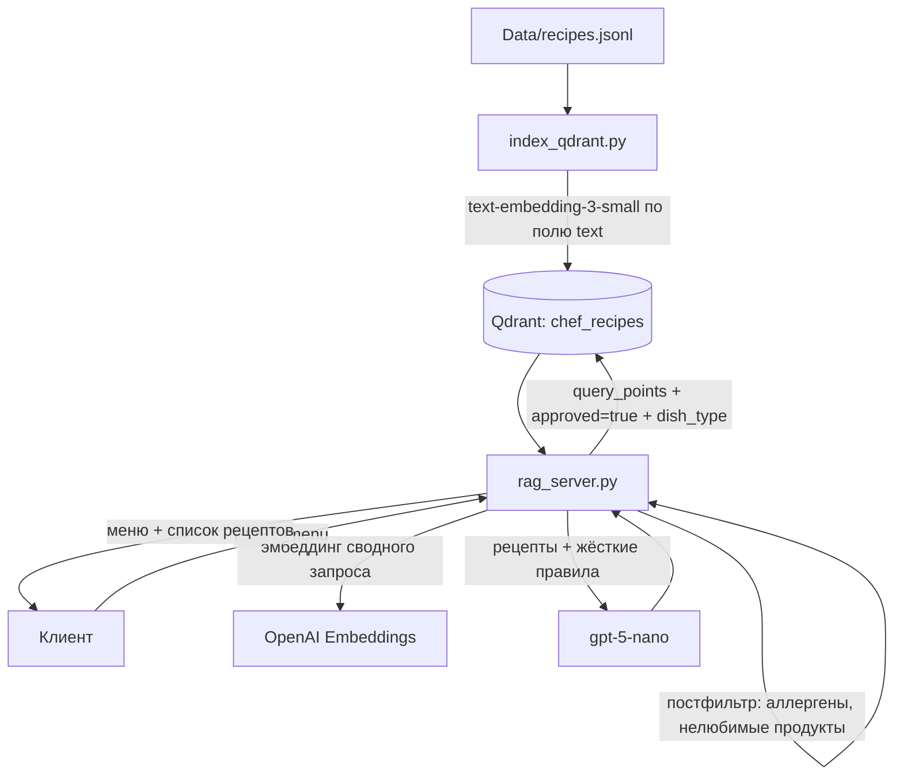

# DirectIndex: простая индексация и поиск рецептов в Qdrant

Решение в папке `DirectIndex/`. Это базовая линия без AutoRAG: полный текст каждого рецепта векторизуется одной моделью эмбеддингов OpenAI и кладётся в Qdrant. FastAPI-сервер выполняет dense-поиск, фильтрует результаты и передаёт их gpt-5-nano для составления меню.

Решение с подбором пайплайна через AutoRAG описано в [AutoRAG.md](AutoRAG.md).

## Схема



## Файлы

| Файл | Назначение |
|---|---|
| `index_qdrant.py` | Индексация `recipes.jsonl` в Qdrant |
| `rag_server.py` | FastAPI-сервер: поиск, генерация меню, получение рецепта по ID |
| `requirements.txt` | Зависимости (fastapi, uvicorn, openai, qdrant-client, httpx, python-dotenv) |
| `.env.example` | Шаблон переменных окружения |
| `Dockerfile`, `Makefile` | Сборка образа, индексация и запуск сервера |

## Индексация (`index_qdrant.py`)

1. Читает `DATA_FILE` (в Docker `/data/recipes.jsonl`, локально `Data/recipes.jsonl`). Каждая строка — объект `{id, text, metadata}`.
2. Векторизует строку `"test"`, чтобы узнать размерность модели (`text-embedding-3-small` = 1536).
3. Если коллекции `QDRANT_COLLECTION` нет, создаёт её с одним безымянным вектором и метрикой `COSINE`.
4. Пачками по 64 векторизует **полный текст рецепта** (`text`: название, тип, ингредиенты, шаги, КБЖУ, аллергены) и делает `upsert`.

Payload точки содержит все поля `metadata` (`approved`, `title`, `dish_type`, `ingredients`, `allergens`, `kcal_per_100g`, `protein_per_100g`, `fat_per_100g`, `carbs_per_100g`, `source`, `photo`, `file`) плюс `text` и `recipe_id`.

ID точки: `uuid5(NAMESPACE_URL, recipe_id)`. Повторный запуск перезаписывает те же точки, дубликатов не появляется. При этом рецепты, удалённые из файла, остаются в коллекции. Чтобы удалить их, пересоздайте коллекцию.

Payload-индексы не создаются. На 2181 точке фильтрация работает и без них, но для роста базы стоит добавить индексы на `approved`, `dish_type` и `recipe_id`.

## Сервер (`rag_server.py`)

### Эндпоинты

| Метод | Путь | Что делает |
|---|---|---|
| `POST` | `/menu` | поиск рецептов + генерация меню gpt-5-nano. Ответ `{menu, recipes}` |
| `POST` | `/recipes` | только поиск (тело как у `/menu`). Ответ `{recipes, next_offset}` |
| `GET` | `/recipes/{recipe_id}` | рецепт по ID (через `scroll` с фильтром), 404 если не найден |
| `GET` | `/health` | проверка работоспособности |

Тело запроса (`MenuRequest`):

| Поле | Тип | По умолчанию | Использование |
|---|---|---|---|
| `kcal_target` | int | обязательно | в тексте запроса и промпте |
| `days` | 1–7 | 1 | в тексте запроса и промпте |
| `meals_per_day` | 1–6 | 1 | в тексте запроса и промпте |
| `allergies` | list[str] | [] | постфильтр + промпт |
| `dislikes` | list[str] | [] | постфильтр + промпт |
| `preferred_dish_types` | list[str] | [] | фильтр Qdrant `dish_type IN (...)` |
| `recently_dish_ids` | list[str] | [] | только в тексте запроса для эмбеддинга |
| `user_notes` | str | null | в тексте запроса и промпте |
| `top_k` | int | 40 | сколько рецептов вернуть |

### Как работает поиск (`retrieve_recipes`)

1. Из полей запроса собирается **один сводный текст**: «Подбери рецепты для меню. Ккал в день: … Аллергии: … Типы блюд: …».
2. Текст векторизуется той же моделью, что и при индексации (`EMBEDDING_MODEL`).
3. `query_points` в Qdrant с фильтром `approved = true` и, если задано, `dish_type IN preferred_dish_types`. Берётся `top_k * 2` кандидатов: это запас под постфильтрацию.
4. Постфильтрация в Python:
   - `has_forbidden_allergen`: убирает рецепт, если один из его аллергенов **точно совпадает** (без учёта регистра) с аллергией пользователя;
   - `has_disliked_ingredient`: убирает рецепт, если нелюбимый продукт встречается **подстрокой** в склеенных ингредиентах.
5. Возвращаются первые `top_k` прошедших фильтр рецептов вместе со `score` (косинусной близостью).

### Как работает генерация (`generate_menu`)

- Каждый найденный рецепт превращается в текстовый блок: ID, название, тип, ккал и БЖУ на 100 г, аллергены, ингредиенты, источник, фото.
- System-промпт задаёт жёсткие правила: только рецепты из списка, без аллергенов, основное блюдо в обед и ужин, напиток в каждом приёме пищи, десерт не чаще раза в день, обязательный `recipe_id`, подбор граммовки под калорийность, ответ на русском.
- User-промпт содержит цели пользователя, блок рецептов и формат ответа: «День N → Прием пищи N: название, recipe_id, граммовка, ккал».
- Вызов `chat.completions.create(model=GENERATION_MODEL)` без `temperature`, что корректно для gpt-5-nano.

### Отладка

При `DEBUG=true` хук `httpx` печатает в stdout каждый запрос к OpenAI: метод, URL, заголовки и тело. **В заголовках будет `Authorization` с API-ключом**, поэтому не включайте режим в общих логах.

## Переменные окружения (`DirectIndex/.env`)

| Переменная | По умолчанию | Назначение |
|---|---|---|
| `OPENAI_API_KEY` | — | ключ OpenAI |
| `OPENAI_BASE_URL` | `https://api.openai.com/v1` | адрес OpenAI-совместимого API. Сервер передаёт его явно, индексатор получает через SDK из окружения |
| `QDRANT_URL` | `http://qdrant:6333` в Docker | адрес Qdrant |
| `QDRANT_COLLECTION` | `chef_recipes` | коллекция |
| `EMBEDDING_MODEL` | `text-embedding-3-small` | модель эмбеддингов (одинаковая для индексации и поиска) |
| `GENERATION_MODEL` | `gpt-5-nano` | модель генерации меню |
| `DEBUG` | `false` | логирование HTTP-запросов к OpenAI |
| `DATA_FILE` | `/data/recipes.jsonl` в Docker | путь к данным для индексатора |

## Запуск

В корневом `docker-compose.yml` для DirectIndex один образ `rag-direct-index` из `DirectIndex/Dockerfile` (Python 3.12) и два сервиса на его основе:

| Сервис | Профиль | Команда | Роль |
|---|---|---|---|
| `direct-index` | — (стартует при `docker compose up`) | `make serve` | **собирает образ** (`build: ./DirectIndex`). FastAPI-сервер на :8000 |
| `direct-index-index` | `index` | `make index` | разовая индексация в том же образе (`pull_policy: never`, секции `build` нет). Порты не публикуются, поэтому запуск не конфликтует с работающим сервером |

Общие настройки вынесены в YAML-якорь `x-direct-index`: образ, `env_file`, `QDRANT_URL`, `DATA_FILE`, монтирование `./Data:/data:ro` и `depends_on: qdrant`. На хосте `make index` сначала собирает образ через `direct-index`, затем выполняет `docker compose run --rm direct-index-index`. Внутри контейнера (`IN_DOCKER=1`) цели выполняются напрямую.

```bash
cd DirectIndex
cp .env.example .env    # вписать OPENAI_API_KEY
make build              # собрать образ rag-direct-index (один на оба сервиса)
make qdrant             # поднять Qdrant
make index              # /data/recipes.jsonl -> коллекция chef_recipes
make up                 # сервер на http://localhost:8000
# или из корня проекта:
# docker compose build direct-index && docker compose run --rm direct-index-index
make logs               # логи; make down — остановить
```

**Без Docker:** `pip install -r requirements.txt`, в `.env` укажите `QDRANT_URL=http://localhost:6333`, затем `python index_qdrant.py` и `IN_DOCKER=1 make serve` (или `uvicorn rag_server:app`).

Пример запроса:

```bash
curl -X POST http://localhost:8000/menu \
  -H 'Content-Type: application/json' \
  -d '{"kcal_target": 2000, "days": 2, "meals_per_day": 3,
       "allergies": ["Глютен"], "dislikes": ["грибы"], "top_k": 30}'
```

Интерактивная документация API: http://localhost:8000/docs

## Ограничения (что улучшает решение AutoRAG)

| Ограничение DirectIndex | Последствие | Как решено в AutoRag |
|---|---|---|
| Один сводный запрос на всё меню, в том числе калории и число дней | Числа и служебные слова не несут смысла для эмбеддинга. В выдаче доминируют основные блюда (1550 из 2181) | Отдельный запрос на каждый слот меню с фильтром `dish_type` |
| Эмбеддинг полного текста с шагами приготовления | Шум в векторе, длинный контекст | Компактная карточка рецепта, модель эмбеддингов выбирается по метрикам |
| Только dense-поиск | Хуже находит точные названия ингредиентов | Гибрид dense + BM25 и реранкер |
| `top_k = 40` полных блоков в контексте | Перегружает gpt-5-nano | 5–10 рецептов после реранкера на каждый запрос |
| Аллергены сравниваются точно, а значения не нормализованы («Молоко», «молочные продукты», «Молочный белок»…) | Часть рецептов с аллергеном проходит фильтр | Фильтр `must_not` в Qdrant по `allergens_lc` (нормализация остаётся задачей) |
| `recently_dish_ids` попадают только в текст эмбеддинга | Недавние блюда не исключаются | Фильтр `must_not` по `recipe_id` |
| `next_offset` в `/recipes` вычисляется, но не используется | Пагинации фактически нет | — |
| Нет оценки качества | Неизвестно, насколько хорош поиск | QA-набор и метрики recall, MRR, nDCG (`evaluate.py`) |
